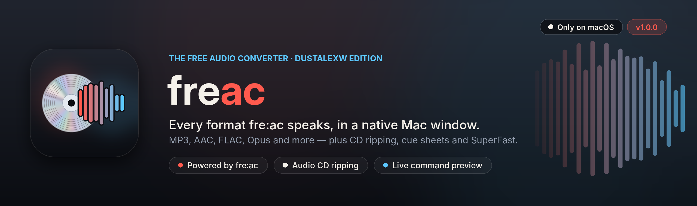

<p align="center"></p>

<p align="center">
  <a href="#build-it-on-your-mac"></a>
  <a href="#build-it-on-your-mac"></a>
  <a href="#requirements"></a>
</p>

# freac (dustalexw edition)

A native macOS front end for **[fre:ac](https://www.freac.org)**, the free audio converter and CD ripper by
Robert Kausch. Every encoder fre:ac ships with — MP3, AAC, FLAC, Opus, Vorbis, WavPack, Monkey's Audio and
more — appears with its own options as native controls, and the exact fre:ac command is shown live at the
bottom of the window.

```
Add files or a disc → Choose a format → Pick where it goes → Convert
```

* **Every fre:ac format, nothing hard-coded.** The app asks fre:ac's own `freaccmd` which encoders it has and
  what each one accepts, so new fre:ac versions and codecs show up on their own.
* **Only real changes are passed on.** Options left at fre:ac's defaults stay off the command line.
* **Audio CD ripping** with CDDB track names, track selection and eject when done.
* **fre:ac's extras:** one combined file with chapters, cue sheets, playlists, SuperFast multi-core
  conversion, cover art and chapter handling.
* **Name files your way** with fre:ac's patterns (`<artist>/<album>/<track> - <title>`), with presets and
  one-click tokens.
* **Nothing hidden.** The live command line at the bottom can be copied straight into Terminal.

Choose **freac (dustalexw edition) → About** for the version, your fre:ac version and encoder count, a
feature overview and links to fre:ac.

## Requirements

* macOS 13 or later, Apple silicon or Intel.
* **fre:ac** itself, from [freac.org](https://www.freac.org/downloads) or the
  [fre:ac releases](https://github.com/enzo1982/freac/releases). The edition finds `freac.app` in
  Applications automatically; otherwise choose it in **Settings**. Homebrew's `freaccmd` works too.
* To build: Swift 5.9 or later (Xcode or the Command Line Tools: `xcode-select --install`).

## Build it on your Mac

Double-click **`build.command`** (or run `./build.command` in Terminal). It compiles a release build, bundles
`build/freac (dustalexw edition).app` with its icon, signs it for your Mac and opens it.

```
./build.command             # your Mac's architecture
./build.command universal   # Apple silicon + Intel (needs full Xcode)
./build.command install     # also copy it to /Applications
```

`VERSION` sets the version number. `scripts/make_brand.py` regenerates the icon, this README's header and the
badges (needs Pillow and the Inter fonts).

## How it works

The edition contains no fre:ac code and changes nothing in fre:ac. It runs fre:ac's command-line converter,
`freaccmd`, which comes with every fre:ac install:

* `freaccmd` with no arguments lists the version and encoders; `freaccmd -h <encoder>` describes each
  encoder's options; `freaccmd --list-drives` lists CD drives. The app reads these
  (`Sources/FreacEdition/Core/FreacHelp.swift`) and builds its controls from them.
* Converting runs the same command you see at the bottom of the window, and progress is read from its output.

The parsing and command building are plain Swift with no UI, and have their own checks against real
`freaccmd` output: `./Tests/core/run.sh` (works on macOS and Linux).

## Credits and licences

fre:ac is © Robert Kausch and contributors, released under the GNU General Public License v2. Source:
[github.com/enzo1982/freac](https://github.com/enzo1982/freac). Each codec fre:ac uses is under its own
licence. This edition is an independent front end and is not affiliated with or endorsed by the fre:ac project.
